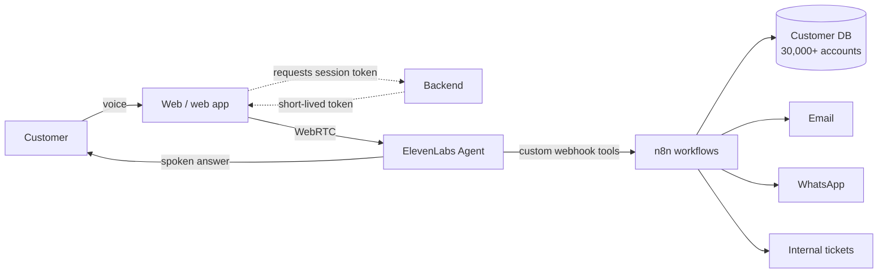

```text
███████╗███████╗██████╗  ██████╗ ██╗ ██████╗
██╔════╝██╔════╝██╔══██╗██╔════╝ ██║██╔═══██╗
███████╗█████╗  ██████╔╝██║  ███╗██║██║   ██║
╚════██║██╔══╝  ██╔══██╗██║   ██║██║██║   ██║
███████║███████╗██║  ██║╚██████╔╝██║╚██████╔╝
╚══════╝╚══════╝╚═╝  ╚═╝ ╚═════╝ ╚═╝ ╚═════╝
███╗   ███╗██╗   ██╗██████╗ ██╗██╗     ██╗      ██████╗
████╗ ████║██║   ██║██╔══██╗██║██║     ██║     ██╔═══██╗
██╔████╔██║██║   ██║██████╔╝██║██║     ██║     ██║   ██║
██║╚██╔╝██║██║   ██║██╔══██╗██║██║     ██║     ██║   ██║
██║ ╚═╝ ██║╚██████╔╝██║  ██║██║███████╗███████╗╚██████╔╝
╚═╝     ╚═╝ ╚═════╝ ╚═╝  ╚═╝╚═╝╚══════╝╚══════╝ ╚═════╝

 ▁▂▃▅▆▇█▇▆▅▃▂▁ ▁▂▄▆█▆▄▂▁ ▁▂▃▅▇█▇▅▃▂▁ ▁▂▄▆█▆▄▂▁ ▁▂▃▅▆▇█▇▆▅▃▂▁

 > AI Solutions Architect · Voice AI · Integrations
 > voice_agents.status()   ● 4 live   ● 650+ real conversations
```

<p align="center">
I turn real operational problems into AI solutions that run in production:<br>
voice agents connected to business systems, automation pipelines and SaaS products.
</p>

<p align="center">
  <a href="https://cv.sergiomurillo.com.ar/"></a>
  <a href="https://www.linkedin.com/in/sergio-murillo-ai/"></a>
  <a href="https://inteliautomake.com"></a>
</p>

---

### ⚡ In numbers

| 20+ years | 15+ MVPs | 30+ automations | 650+ conversations |
|:---:|:---:|:---:|:---:|
| building technology solutions | and 2 startups | running in production | handled by my voice agent Greicy |

---

### 🎙️ Voice agents you can try live

Real-time conversations built on **ElevenLabs Agents** + **WebRTC**. A backend issues short-lived session tokens, so the private API key never reaches the browser.

| Agent | What it does | Status |
|---|---|---|
| **Greicy** · Parque de la Paz | Customer-service agent connected to a database of 30,000+ customers. Explains each account in the conversation, emails the details, logs internal tickets and sends WhatsApp messages. 650+ real conversations since 2025. | 🟢 In production · [Try it](https://inteliautomake.com/parquedelapaz/QR/index.html) |
| **My AI agent** · Portfolio | Answers questions about my experience and projects, by voice or text | 🟢 Live · [Try it](https://cv.sergiomurillo.com.ar/) |
| **Custom Voice Agent UI** | My own widget on the `@elevenlabs/client` SDK: avatar, voice + text chat, agent profile loaded from my backend | 🟢 Live · [Try it](https://inteliautomake.com/agente4/public4/index.html) |
| **Botcats** | A feline assistant with a custom cat voice and personality (yes, it says "miauuu") that teaches owners how to prevent diabetes in cats | 🟢 Live · [See project](https://inteliautomake.com/OLLD/proyecto-botcats/index.html) |

**How Greicy works**



---

### 🚀 Products I've built

**[Studio Media Labs](https://studiomedialabs.com/)** — Generative AI media production SaaS
Creator, architect and full-stack developer. Serverless, modular platform with an in-app AI agent, integrating the **ElevenLabs API for voice generation and music**.
🏅 Selected for pre-incubation at the Atlantis Technology Incubator, Universidad Nacional de Mar del Plata (July 2026) — one of 7 projects admitted in the technology category.
`ElevenLabs API` `Python` `TypeScript` `React` `React Flow` `Node.js` `Supabase` `Docker` `Cloudflare` `Railway`

**[AIQR]()** — AI agents behind QR codes
Puts conversational agents on products, signage, equipment and spaces: answers questions, qualifies leads and logs interactions.
`Next.js` `PostgreSQL` `Supabase`

---

### 🧰 Tech stack

**Voice AI & agents**


**Languages & frameworks**


**Automation & integrations**


**Data, cloud & infra**


**AI models**


---

### 🏗️ What I do

- **Design** voice and chat agents connected to the systems a business already runs: customer databases, email, WhatsApp, ticketing, telephony.
- **Demo** solutions to business and technical stakeholders, translating between both.
- **Deploy** from architecture to production: integrations, security, monitoring and iteration.
- **Enable** teams through training: speaker at Universidad Atlántida Argentina's technology conference (2025), trainer at the AIStars Foundation, and corporate workshops on AI agents.

Today I'm **Founder** of [Inteliautomake](https://inteliautomake.com), **CTO** at Parque de la Paz, and Head of the Technical Division for IT & Telecommunications at Universidad Nacional de Mar del Plata.

---

### 📜 Recent certifications

`AI Fluency for Educators — Anthropic (2026)` · `MCP: Automation in Production — Hugging Face (2026)` · `Fundamentals of MCP — Hugging Face (2025)` · `Long-Term Agentic Memory with LangGraph — DeepLearning.AI (2025)` · `Building Agentic RAG with LlamaIndex — DeepLearning.AI` · `Generative AI Bootcamp — AWS (2023)`

---

<p align="center">
📍 Mar del Plata, Argentina · 🌎 Remote with teams across LATAM and Europe · ✈️ Available to travel<br><br>
<a href="https://cv.sergiomurillo.com.ar/"><b>→ Talk to my AI agent on my portfolio</b></a>
</p>
